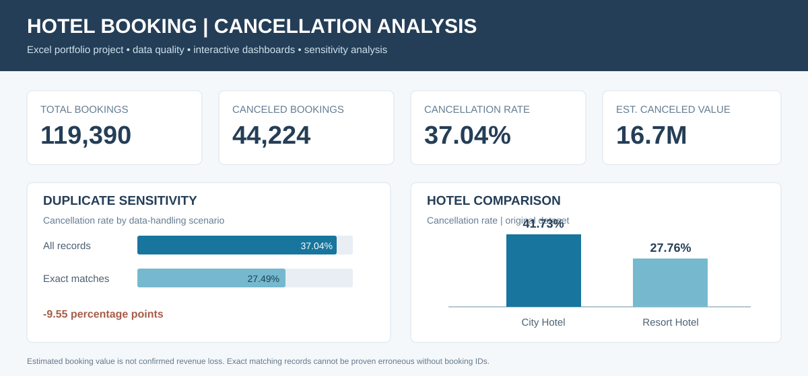

# Hotel Booking Cancellation Analysis

**Excel Data Analytics Portfolio** | Data Cleaning · Quality Assurance · PivotTables · Interactive Dashboards · Sensitivity Analysis

An end-to-end analysis of hotel booking cancellations across **119,390 records**. The project combines data auditing, documented cleaning decisions, exploratory analysis, and **two interactive Microsoft Excel dashboards**. A separate sensitivity analysis tests how the results change when exact matching rows are excluded.

> **Important:** Estimated canceled booking value is an estimate of booking-value exposure, **not confirmed revenue loss**. The dataset does not specify a currency.

## Project question

**Which booking characteristics and segments show elevated cancellation rates, and how sensitive are the findings to data-quality decisions?**

### Key indicators — full original dataset

| Indicator | Value |
|:--|--:|
| Bookings | **119,390** |
| Canceled bookings | **44,224** |
| Cancellation rate | **37.04%** |
| Average booking lead time | **104.0 days** |
| Estimated canceled booking value | **16,727,237.12** |

### Hotel-level findings

| Hotel | Bookings | Canceled | Cancellation rate |
|:--|--:|--:|--:|
| City Hotel | 79,330 | 33,102 | **41.73%** |
| Resort Hotel | 40,060 | 11,122 | **27.76%** |

The **Non Refund** deposit category recorded **14,494 cancellations out of 14,587 bookings (99.36%)**. This unusually high association should be investigated; the data **do not establish causation**.

**Online TA** accounted for approximately **10,227,646.11** in estimated canceled booking value across the two hotels. This is exposure associated with canceled bookings, not a measured financial loss.

In the complete calendar year **2016**, October's cancellation rate was **40.53%** (2,514 / 6,203) versus **24.78%** (557 / 2,248) in January. The 2015 and 2017 data cover partial years, so direct seasonal comparisons require caution.

## Sensitivity analysis: exact matching records

During data-quality review, **31,994 additional rows** were identified as exact matches across the original **32 booking fields**.

Because the source has **no unique booking ID**, these matches are not automatically treated as erroneous duplicates. The primary dashboards **retain all original records**; a secondary scenario removes repeated exact matches to show how results would change.

| Measure | A — All records | B — Exact matches removed |
|:--|--:|--:|
| Booking records | 119,390 | 87,396 |
| Canceled records | 44,224 | 24,025 |
| Cancellation rate | **37.04%** | **27.49%** |
| Estimated canceled booking value | 16,727,237.12 | 11,484,042.98 |
| Highest-risk eligible market segment | **Groups** | **Online TA** |

The overall cancellation rate changes by **−9.55 percentage points** between the scenarios. The **Sensitivity Analysis** sheet also provides group-level comparisons and explains the methodology and limitations.

This comparison does **not** prove which of the scenarios reflects the number of distinct real-world bookings; it makes the effect of the uncertain duplicate-handling decision explicit.

## Dashboards

**Dashboard — Cancellation Intelligence**
- Five KPI cards: bookings, cancellations, cancellation rate, average lead time, and estimated canceled booking value.
- Visual comparisons by hotel, lead-time category, deposit type, market segment, and monthly booking volume.

**Risk Deep Dive**
- High lead-time cancellation risk and most-exposed market segments.
- Deposit type × market segment, seasonal risk, and estimated canceled value by hotel.
- Analysis notes and recommendations for follow-up investigations.

Both dashboard sheets have dropdowns for **Hotel**, **Arrival Year**, **Market Segment**, and **Deposit Type**. Some category comparisons intentionally exclude their own filter so that categories can still be compared.

For **All Years**, the Risk Deep Dive seasonal chart uses **2016 as its complete-year baseline**. A high cancellation rate among bookings made 360+ days in advance in 2015 (**96.24%**) is based on **266 bookings** (256 canceled), illustrating the importance of sample-size context.

### Dashboard screenshots

The finished screenshots can be uploaded to the **assets/** folder as **dashboard_overview.png** and **risk_deep_dive.png**. The vector graphic above is a KPI overview, *not* a screenshot of the live Excel interface.

## Workbook structure and workflow

The latest workbook contains **17 worksheets**, grouped into:

| Stage | Sheets |
|:--|:--|
| Data quality | **clean data**, **Audit**, **cleaning Log** |
| Core analysis | **Hotel Comparison**, **Market Segment**, **Deposit Analysis**, **Lead Time Analysis**, **Cancellation Overiew** |
| Extended analysis | **Revenue Risk Analysis**, **Revenue by Segment**, **Canecllation  Drivers Analysis**, **Monthly&Seasonal Analysis**, **Business Insights** |
| Sensitivity | **Sensitivity Analysis** |
| Dashboards and calculation engine | **Dashboard**, **Risk Deep Dive**, **Dashboard Engine** |

*Sheet names reflect the workbook's actual tab labels; some original tab names contain spelling or spacing variations.*

1. Review missing and unusual values, zero-night reservations, unusual ADR, guest counts, and exact matches.
2. Document the handling decisions in **Audit** and **cleaning Log**.
3. Use PivotTables to compare cancellation performance and booking-value exposure.
4. Build the interactive dashboards with a supporting **Dashboard Engine**.
5. Quantify the effect of the duplicate-handling decision in **Sensitivity Analysis**.
6. Summarize evidence and suggested investigations in **Business Insights**.

## Definitions

- **Cancellation rate:** canceled booking records ÷ total booking records.
- **Estimated booking value:** ADR × (weekend nights + weekday nights).
- **Estimated canceled booking value:** sum of estimated booking values for rows with is_canceled = 1.
- **Canceled bookings:** based on the dataset's is_canceled field; **No-Show** cases are included in the canceled classification.
- **Change in rates (pp):** difference in percentage points, not percent relative change.

## How to view

The full **hotel_bookings_Analysis.xlsx** workbook is intended to be opened in **Microsoft Excel for desktop** once uploaded to this repository. GitHub file previews do not execute the interactive Excel dashboards.

Use the **Dashboard** and **Risk Deep Dive** tabs for the visuals, **Sensitivity Analysis** for methodology robustness, and **Audit** / **cleaning Log** to review the data-quality decisions.

## Scope and limitations

- The analysis uses a **static dataset**, not live hotel operations.
- Exact matches cannot be verified as true duplicates without unique booking identifiers; both scenarios are provided.
- The dataset's currency is **unspecified**, and canceled booked value is not proof of realized revenue loss.
- The results are **descriptive associations, not causal effects**.
- A subgroup with an extreme cancellation rate may have a relatively small sample.
- **Data source and redistribution terms should be verified before publishing the full underlying booking-level data**. When permissions are unclear, publish dashboard screenshots, analysis summaries, and documentation rather than redistributing the dataset.

---

**Tools:** Microsoft Excel · PivotTables · Excel formulas · Data-quality auditing · Interactive visualization.
